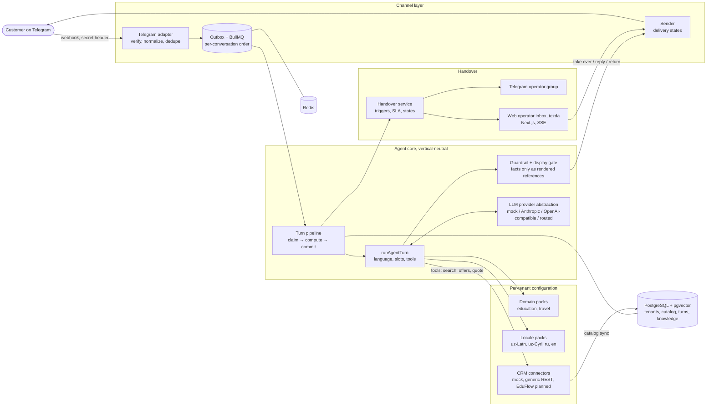

# AgentCore (tezda)

AgentCore is a multi-tenant AI sales and support agent. It answers customers in their own language and script (Uzbek in Latin and Cyrillic, Russian, English) on Telegram. Every hard fact (price, date, seats, schedule) comes from the business's CRM or database through tools, never from the model's memory. When a human is needed, it hands the conversation over to an operator. The operator inbox's user-facing brand is **tezda**.

Onboarding a new business is configuration, not core code: a **Domain Pack** (what is sold and which details to ask for), a **CRM Connector** (where the facts live), a **Locale Pack** (language, script, templates) and tenant settings.

`AGENTS.md` is the lean project index. The full specification is in `docs/spec/` (start at `docs/spec/README.md`), the current state is at the top of `docs/PROGRESS.md`, and design decisions are in `docs/adr/`.

- [Architecture](#architecture)
- [Quick start](#quick-start)
- [Running the tests](#running-the-tests)
- [Demo script (5–7 minutes)](#demo-script-57-minutes)
- [Status: what is tested and what is not](#status-what-is-tested-and-what-is-not)
- [Secrets and customer data](#secrets-and-customer-data)
- [Developer reference](#database-development)

## Architecture



- **The agent core** (`apps/api/src/core/`) has nothing vertical- or CRM-specific in it. Hard facts enter a reply only as `{{F<n>}}` references that code renders from this turn's tool results, with provenance (ADR 013).
- **Conversation states:** `BOT_ACTIVE`, `WAITING_OPERATOR`, `OPERATOR_ACTIVE`, `CLOSED`. The bot stays silent unless the conversation is `BOT_ACTIVE`.
- **Agent mode per channel account:** `OFF`, `SHADOW` (drafts only, nothing sent) or `LIVE`.

## Quick start

**Requirements:** Node.js 24 (or 20.19+ / 22.12+, see `.nvmrc`), pnpm 10+, and Docker with Compose. Compose provides PostgreSQL 16 with pgvector (`pgvector/pgvector:pg16`) and Redis 7.

```sh
cp .env.example .env                 # names and safe defaults; .env is gitignored, so real keys can go here
pnpm install
docker compose up -d                 # postgres (pgvector) + redis
pnpm db:generate && pnpm db:migrate  # Prisma client + checked-in migrations
pnpm db:seed                         # optional repeatable development seed (refused in production)
```

The repository is a pnpm workspace:
- the NestJS API is in `apps/api`;
- the operator inbox (Next.js, brand tezda) is in `apps/web`;
- shared contracts and configuration are in `packages/`.

Run the API and the web inbox in two terminals (in VS Code, the task **Dev: API + Web** in `.vscode/tasks.json` opens one terminal each):

```sh
cd apps/api && API_HOST=127.0.0.1 pnpm start:dev   # API on 127.0.0.1:4000, rebuilds on change
cd apps/web && pnpm dev                            # web on 127.0.0.1:3000, proxies /api to the API
```

Check `http://127.0.0.1:4000/health` for `{"status":"ok"}`, then open **`http://localhost:3000`**. The browser only talks to the web origin; `/api/*` is proxied.

Open exactly an origin listed in `WEB_ORIGINS` (default `http://localhost:3000`). The API refuses state-changing requests from any other origin with `BAD_ORIGIN`, and `127.0.0.1` is a different origin from `localhost`: with `http://127.0.0.1:3000` you can log in, but Take over is refused.

**Ports.** All are variables, so the stack can run beside other local servers:

| What | Variable | Default |
|---|---|---|
| API | `PORT` in `.env` | 4000 |
| Web | `PORT` in the web's shell, plus `API_URL` (the API address) | 3000, `http://127.0.0.1:4000` |
| Allowed browser origin | `WEB_ORIGINS` in `.env` | `http://localhost:3000` |
| Compose PostgreSQL host port | `POSTGRES_PORT` in `.env` (the API connects to the same value) | 5432 |
| Test database port | `TEST_POSTGRES_PORT` in `.env`: change it together with `POSTGRES_PORT`, or the tests reach another PostgreSQL | 5432 |
| Compose Redis host port | `REDIS_PORT` in `.env`, together with `REDIS_URL` | 6379 |

For example, with port 4000 already taken: in `.env` set `PORT=4100`, `WEB_ORIGINS=http://localhost:3100` (and, if 5432 and 6379 are busy too, `POSTGRES_PORT=55432`, `TEST_POSTGRES_PORT=55432`, `REDIS_PORT=56379`, `REDIS_URL=redis://localhost:56379`), then start the web with `PORT=3100 API_URL=http://127.0.0.1:4100 pnpm dev` and open `http://localhost:3100`. The e2e tests use their own fixed ports (web 3010, API 4010, fake Telegram 4020).

**Environment.** Every variable is listed with an explanation in `.env.example`. The defaults run fully offline:
- `LLM_PROVIDER=mock` is a deterministic model with no network calls;
- the Telegram variables are unset;
- `FOLLOWUP_ENABLED=false`;
- `KNOWLEDGE_EMBEDDINGS=off`.

Real keys (LLM providers, a Telegram test bot, `SECRETS_MASTER_KEY`) go only into `.env` (gitignored) or the shell, never into a committed file. The API reads only the root `.env` (or the file named by `ENV_FILE`) plus the shell; `.env.local` is read only by `pnpm llm:smoke` and `eval:live`.

**Local login (development only):**

```sh
cd apps/api && pnpm dev:superadmin --demo   # once; idempotent; --reset-password to rotate
pbcopy < ~/.config/agentcore/dev-superadmin.password   # macOS: copy the password, it is never printed
```

Login `superadmin@agentcore.local`. **Local development only; change it in any real environment.** The same applies to the Compose database login `agentcore` / `agentcore` in `.env.example`. A second checkout on the same machine overwrites the password file; give it its own directory with `AGENTCORE_DEV_SECRETS_DIR`. This is an `OWNER` of one dedicated local tenant (fake data), not a platform administrator: there is no cross-tenant role ([ADR 025](docs/adr/025-local-development-superadmin.md)). The script refuses anything but `NODE_ENV=development` on a localhost database, stores only an scrypt hash, and writes the password to a 0600 file outside the repository. With the real Telegram bot token in `.env`, do not reply from the local demo conversations: the demo channel account is fake and a reply would try to reach Telegram.

## Running the tests

| Command | What it checks | Needs |
|---|---|---|
| `pnpm lint`, `pnpm typecheck`, `pnpm format:check` | Static checks across the API, the web app and shared packages | nothing |
| `pnpm test` / `pnpm test:unit` | API unit tests, including the deterministic eval suite with a scripted model; `test:unit` also runs the web unit tests | nothing |
| `pnpm test:integration` | Real-PostgreSQL tests (webhook acceptance, idempotency, ordering, handover, connectors, secret store, simulation harness) | Compose Postgres. Run `pnpm db:test:seed` first (as CI does): one persistence test expects the seeded demo tenants. It creates and marks an isolated `agentcore_test` database and refuses any other |
| `pnpm test:eval` | The evaluation gate: scripted eval cases and business-action lifecycle cases; mock models only, no network | Compose Postgres |
| `pnpm test:e2e` | Playwright end-to-end tests of the inbox, including accessibility checks | a built app; CI installs Chromium |
| `pnpm check:onboarding` | Universality gate: a commit that onboards a domain pack (trailer `Pack-Onboarding: <pack>`) must not change the core | git history |
| `pnpm build` | Production build of every package | nothing |

CI (`.github/workflows/`) runs all of the above on every push, on a fresh pgvector database, including migration drift checks.

**Live and simulation runs are opt-in and never run in CI:**
- `eval:live` calls a real model and is billable or quota-limited;
- `simulate` runs scenarios with a free-tier model against a dedicated `agentcore_*` database.

See the developer reference below.

## Demo script (5–7 minutes)

Offline: mock model, no Telegram, no keys. Steps 3 and 4 need a Telegram test bot only if you want real traffic; everything else is local.

1. **Start (1 min).** Run Quick start, `pnpm dev:superadmin --demo`, then the API and the web app. Log in at `http://localhost:3000` (the `WEB_ORIGINS` origin, see Quick start) as `superadmin@agentcore.local`.
2. **Operator inbox (1–2 min).** The demo seeds three fictional conversations, in Uzbek, Russian and English. Each customer asked for a person, so each conversation is `WAITING_OPERATOR` with a `CUSTOMER_REQUEST` handover.
   - Open one, then **Take over**: the state becomes `OPERATOR_ACTIVE` and the bot stays silent.
   - Then **Return to bot**. Status changes stream live over SSE.
   - Do not send a reply from a demo conversation. Its channel account is fake, and a reply would try to reach Telegram.
3. **A simulated conversation through the real pipeline (1–2 min).** This needs the Compose Postgres; it creates its own `agentcore_test`.

   ```sh
   pnpm db:test:prepare
   pnpm --filter @agentcore/api exec vitest run --config vitest.integration.config.mts \
     src/agent/testing/simulation/simulation.integration.spec.ts
   ```

   A scripted customer and a scripted model go through the real webhook, queue, agent turn, guardrail and handover code. The tests show:
   - a grounded recommendation;
   - a correct handover;
   - a confirmed business action reaching the (fictional) CRM;
   - the clock advancing after a quoted price. On `main` this test still pins the old "no follow-up" result; the harness wiring fix that makes the follow-up fire is on the unmerged measurement branch (DEF-001).
4. **Shadow mode (1–2 min).** Switch a channel account to `SHADOW`:

   ```sh
   pnpm --filter @agentcore/api agent:mode <channel-account-uuid> shadow
   ```

   For a test bot, `TELEGRAM_TEST_OPERATOR_CHAT_ID=<operator group id> pnpm --filter @agentcore/api telegram:account` (the variable is required) creates a fake tenant with a SHADOW test account, and `docs/TELEGRAM_TEST_PROCEDURE.md` walks through the webhook. In SHADOW every inbound message produces a draft and a turn record in `agent_turns` (outcome, tool calls, guardrail result, cost), and **nothing is sent to the customer**.
5. **Handover (1 min).** A request for a person, a complaint, a price negotiation, a guardrail refusal or a stuck conversation opens a typed handover (`CUSTOMER_REQUEST`, `COMPLAINT`, `NEGOTIATION`, `GUARDRAIL`, `STUCK`, …). It appears in the inbox and, with an operator group configured, as a card in Telegram with Take over / Return buttons.

**Checked on 2026-10-27 in a fresh clone** (macOS, Compose on host ports 55432/56379, API on 4100, web on 3100). The clone ran on **Node 26.7.0** (pnpm 10.33.3), outside the supported engines, so pnpm warned. **CI runs Node 24** (`.github/workflows`, `node-version: 24`), so Node 24 results come from CI, not from this run:
- Quick start: install, Compose up (healthy), 20 migrations, seed.
- Local login through the web origin; the three demo conversations, all `WAITING_OPERATOR`.
- Take over (`OPERATOR_ACTIVE`), then Return to bot (`BOT_ACTIVE`), done through the web proxy's API, not by clicking in a browser.
- Step 3's simulation spec; step 4's test account, `SHADOW`, and LIVE refused outside development.
- Every command in the test table passed. Three of them first needed the fixes now in this README and branch: seed before `test:integration`, a test that read `LLM_PROVIDER` from `.env`, and `next-env.d.ts` excluded from `format:check`.
- Not checked: real Telegram traffic, the operator-group card (step 5), and the Mermaid diagram rendering.

## Status: what is tested and what is not
_As of 2026-10-27: this branch includes `main` at `438f148`; the latest `main` with a completed green CI run is `7e287c1` (CI run 40481962249)._

**Tested in CI (deterministic, no live model):**
- Telegram webhook acceptance, idempotency, per-conversation ordering and delivery states.
- The agent turn with a scripted model: slots, tools, guardrail, display gate, locale choice.
- Handover state machine and operator actions.
- Business-action lifecycle; connector conformance (mock, generic REST); catalog sync.
- Encrypted channel secret store and per-account Telegram credentials.
- The channel connect API and the Channels page that uses it (ADR 028 S3–S4), against a fake Telegram in e2e.
- Knowledge retrieval plumbing; follow-ups.
- The web inbox, with end-to-end and accessibility tests.
- The evaluation gate: scripted cases in four locales, plus lifecycle cases.

**Not tested, or tested only partly:**
- **Model quality with a real model is measured, not gated.** The free-tier Groq "before" baseline: lane `openai/gpt-oss-20b` / `openai/gpt-oss-120b`, k=1, agent commit `9a653e7`, scenario hash `38f47101a367`.
  - It is partial (112 of 130 units attempted; the per-day quota stopped it).
  - **30 of 111 completed runs passed.** 22 of those 30 are scenarios where handing over is the right answer; all other scenario types passed 8 of 88.
  - The dominant failure was the display gate refusing listed prices and uncitable numbers (53 of 71 agent failures). 0 invented facts and 0 false success claims.
  - Details: [breakdown](docs/evidence/slice1c-groq-baseline-breakdown.md) and [assessment](docs/evidence/slice1c-groq-baseline-assessment.md).
- **Measurement ladder, core-30 units (same lane, k=1, scenario hash `38f47101a367`, mock connector; measurement-only commits, not merged):**

  | Step | Agent commit | Change | Passed |
  |---|---|---|---|
  | Before | `9a653e7` | — | 7/30 |
  | 1 | `de31ebf` (tag `measure/step1-de31ebf`) | harness wiring + blocked-draft diagnostics | 8/30 |
  | 1a | `44afcf9` (tag `measure/step1a-44afcf9`) | DEF-001 product fix | 11/30 |

  - **k=1, within noise.** One unit flipped back and forth with no relevant change, so the differences are not attributed to either change.
  - 0 invented facts and 0 false success claims in all three.
  - Blocked-draft diagnostics: 96–98% of the numbers the guardrail blocked had been shown to the model in a tool result. They were copied, not invented.
  - Details: [ladder evidence](docs/evidence/ladder-step1-1a.md).
- **Real Telegram:** live runs were done manually in development and recorded as evidence. LIVE mode is still refused outside development until the owner decides.
- **Locales:** all four are `beta`. There is no native-speaker review yet.
- **Not built or tested:** voice and media; load or soak; backup and restore; production deployment.

**Known defects** (`docs/DEFECTS.md`):
- **DEF-001**, quoted price not recorded for follow-up: re-diagnosed on the unmerged measurement branch `measure/step1-1b-i`. The follow-up part was a simulation-harness wiring gap. The missing `Quote` row is a real product defect, fixed there and not merged.
- **DEF-002:** the travel pack has no high-value threshold.
- **DEF-003:** no retail pack.
- **DEF-004:** fixed.
- **DEF-005–008** come from the Telegram live runs ([evidence](docs/evidence/telegram-live-2026-10-26.md)). Of these, **DEF-007** (timestamps stored 5 h early under a non-UTC database session) is **fixed on `main`** (`6e138a1`).
- **DEF-009–011:** fixed on `main` (channel connect API).

**Deferred by owner decision:**
- **A real CRM connector.** Phase 3 is partial. The EduFlow (Learnix) connector is cancelled for now (owner, 2026-10-27); its plan stays on `main` as docs (`docs/connectors/eduflow/`).
- **amoCRM (OAuth2 with rotating refresh tokens)** as a lead/contact sink (catalog capability off; offer facts need another source). The Bitrix24 lead sink exists: see [Bitrix24 lead sink (optional)](#bitrix24-lead-sink-optional).
- **Meta channels** (Instagram, Messenger, WhatsApp; Phase 8).
- **Production** (Phase 9: security review, load tests, backup drill, staging, deploy).

**Phase roadmap** (`docs/spec/12-roadmap.md`, `docs/PROGRESS.md`):

| Phase | Scope | Status |
|---|---|---|
| 0 | Foundation (monorepo, CI) | done |
| 1 | Domain and persistence | done |
| 2 | Telegram channel + queue | done |
| 3 | Connector framework | partial: framework, mock and generic REST done; no real CRM connector (deferred) |
| 4 / 4B | Agent core, packs, locales | done (locales `beta`) |
| 5 | Handover and leads | done; LIVE outside development awaits the owner |
| 6 / 6A | Knowledge, follow-ups; web operator inbox | done; voice deferred |
| 7 | Evaluation and universality proof | in progress (scripted eval gate done; real-model quality measured, not gated) |
| 8 | Meta channels | not started (deferred) |
| 9 | Hardening and production | not started |
| 10 | Self-serve and scale (tenant admin UI) | channel-connect API only, no UI |
| 11 | New languages | not started |

Agent platform v2 (ADR 026) proceeds in slices. The next is slice 1b (ADR 029, citable offer details), with a measurement ladder on the same scenario hash.

## Secrets and customer data

- `.env` and `.env.*` are gitignored. Only `.env.example` is tracked, and it holds names and safe placeholders.
- **History check (2026-10-27):** this was a **git history search, not a gitleaks scan** (no secret scanner such as gitleaks, trufflehog or detect-secrets was installed). All 216 commits on every branch were searched with key-shape patterns. The only env-like file ever committed is `.env.example`. No key-shaped string appears in any added line: Groq, Anthropic, OpenAI-style, Google API key, Telegram bot token, GitHub, Slack, AWS, private-key blocks, 32-byte base64 keys. None of the local `.env` secret values appears anywhere in history.
- Channel bot tokens are stored encrypted (AES-256-GCM, `SECRETS_MASTER_KEY`, ADR 028). Responses, logs and audit rows never contain them.
- Free-tier LLM providers may use submitted content, so they get synthetic data only. Real customer data goes only to providers listed in `LLM_TRUSTED_PROVIDERS`.

## Developer reference

## Database development

The API uses Prisma 7 with PostgreSQL's `pg` driver adapter. Copy `.env.example` to `.env` before running Prisma commands or starting the API, then start local services with `docker compose up -d postgres`. For the API running directly on the host, `POSTGRES_HOST=localhost`; an API container on the Compose network should use `POSTGRES_HOST=postgres`. The local example sets `POSTGRES_SSL_MODE=disable`; the secure default for remote PostgreSQL is `verify-full`, which requires TLS and validates the server certificate. `require` encrypts traffic but does not validate the certificate. The application creates one Prisma Client and one bounded connection pool, and closes both on Nest shutdown. Generate the client with `pnpm db:generate` and apply checked-in migrations with `pnpm db:migrate`. The development seed is repeatable and disabled when `NODE_ENV=production`; run it with `pnpm db:seed`.

Prisma CLI commands and application runtime use `POSTGRES_HOST`, `POSTGRES_PORT`, `POSTGRES_DATABASE`, `POSTGRES_USER`, and `POSTGRES_PASSWORD`; `POSTGRES_SSL_MODE` defaults to `verify-full` when omitted. Prisma CLI builds an encoded connection URL from those values in `apps/api/prisma.config.ts`; runtime uses the same validated values directly in the `pg` adapter. Integration tests use the parallel `TEST_POSTGRES_*` variables for the isolated `agentcore_test` database. `pnpm test:integration` creates that database only if absent, tags it with an AgentCore test marker, applies migrations, and runs real-PostgreSQL tests. It refuses an unmarked existing database, a different test database name, or the configured development database. It does not drop or reset any database. Use `pnpm db:test:seed` and `pnpm db:test:drift` for the corresponding test-database checks.

Run `pnpm lint`, `pnpm typecheck`, `pnpm test`, and `pnpm format:check` before submitting changes.

## Telegram text-channel development

A Telegram bot is connected per channel account ([ADR 028](docs/adr/028-channel-connection-from-the-web.md)). An OWNER or ADMIN connects it from the web Channels page (`POST /api/v1/channels/telegram` with the bot token), which needs `SECRETS_MASTER_KEY`; the token and webhook secret are stored encrypted in the channel secret store and never returned. The older environment trio (`TELEGRAM_CHANNEL_ACCOUNT_ID`, `TELEGRAM_BOT_TOKEN`, `TELEGRAM_WEBHOOK_SECRET`, all-or-none) still works as a fallback for the one account it names; stored secrets win over it. The webhook path is `POST /webhooks/telegram/<channel-account-uuid>`. The application authenticates `X-Telegram-Bot-Api-Secret-Token`, validates text updates, persists the event, inbound message, and outbox job in one PostgreSQL transaction, then acknowledges. `TELEGRAM_RATE_LIMIT_PER_MINUTE` defaults to 120 per account. Do not put token or secret values in source control or logs.

For local webhook development, expose the API through an HTTPS tunnel and configure Telegram's official `setWebhook` method with that URL and the same `secret_token`. Telegram sends the secret in `X-Telegram-Bot-Api-Secret-Token`; set `allowed_updates` to `message`. The API does not call `setWebhook` automatically. Unsupported non-text updates are acknowledged and ignored. Inbound text bursts are grouped for a 2 second window and serialized with a PostgreSQL advisory lock per conversation. The sender records `SENT`, `FAILED`, or `UNKNOWN`; a lost response can leave delivery ambiguous, so the system does not blindly resend that message.

Use `pnpm test:unit` for deterministic adapter tests and `pnpm test:integration` for webhook acceptance, PostgreSQL idempotency, debounce/order, and delivery-state tests. The integration suite requires the marked isolated `agentcore_test` database. Queue runtime checks require Redis from Compose.

## Bitrix24 lead sink (optional)

AgentCore can send its leads to a Bitrix24 cloud portal. The connector creates leads only; it reads no catalog, prices or availability, so offer facts still come from the catalog connector (the mock catalog in development). Plan, probe results and limitations: [docs/connectors/bitrix24/CONNECTOR_PLAN.md](docs/connectors/bitrix24/CONNECTOR_PLAN.md).

1. **Use a test portal with synthetic data only.**
2. **Create an inbound (incoming) webhook** in the portal ([official guide](https://apidocs.bitrix24.com/local-integrations/local-webhooks.html)) and give it **only the CRM scope (`crm`)**. The webhook runs with the permissions of the employee who creates it.
3. **The webhook URL is the credential:** it contains the secret code. Put it in `.env` as `CONNECTOR_SECRET_BITRIX24_WEBHOOK_URL`, never in source control, chat, logs or tenant config. The connector config stores only the reference: `{ "webhookSecretRef": "env:CONNECTOR_SECRET_BITRIX24_WEBHOOK_URL" }`, optionally with `sourceId` (default `OTHER`) and `titlePrefix` (default `Telegram`).
4. **Lead routing is a stopgap.** Lead sync sends a lead to the oldest active connector that can create leads. To use the mock catalog and Bitrix24 together, set the mock's config to `createLead: false`. A proper lead-sink role in the core needs an ADR.

What it does:
- It checks the customer's phone for duplicates in code; only record IDs leave the CRM.
  - An existing lead gets the conversation summary as a timeline comment, and its fields are not changed.
  - A matching contact gets a new lead linked to it.
- It refuses to write when the CRM runs in simple mode (no leads).
- It calls only six allow-listed methods.

Optional checks against the test portal (they make real calls; the URL is never printed):
- `pnpm --filter @agentcore/api exec tsx scripts/bitrix24-probe.ts <dir outside the repo>`
- `SIM_POSTGRES_DATABASE=<dedicated agentcore_* db> pnpm --filter @agentcore/api exec tsx scripts/bitrix24-demo.ts`

CI uses recorded, scrubbed response shapes and a fake portal; it never calls Bitrix24.

## Agent core and LLM development

Phase 4 adds the provider-neutral agent core (`apps/api/src/core/`), the education Domain Pack (`apps/api/src/packs/education/`) and the uz-Latn, uz-Cyrl, ru and en Locale Packs (`apps/api/src/locales/`, all `beta` until native review). The default is `LLM_PROVIDER=mock`: a deterministic provider that makes no network calls and never invents facts. To use Claude, set `LLM_PROVIDER=anthropic` and `ANTHROPIC_API_KEY`. Startup refuses a missing key or a model without a pricing entry in `LLM_PRICING_VERSION`.

Every model call reserves its worst-case cost before it is sent and settles against the usage the provider reports. Calls are bounded by `LLM_TURN_BUDGET_USD`, `LLM_CONVERSATION_BUDGET_USD`, the optional `LLM_TENANT_MONTHLY_BUDGET_USD`, and the call, tool-round and input-size limits in `.env.example`. Usage and cost are stored in nano-USD in `LlmUsageRecord`. A turn that runs out of budget hands over with reason `BUDGET_EXCEEDED` (tool-loop limits: `TOOL_LOOP_LIMIT`). Model prices are versioned config in `apps/api/src/llm/pricing-catalog.ts`, with source URL and `asOf` date. Startup warns when they are more than 30 days old. See `docs/adr/008-llm-provider-and-cost-controls.md` and `docs/LLM_PROVIDER_EVALUATION.md`.

`pnpm test:unit` includes the deterministic eval suite: `eval/cases/education/<locale>/cases.json`, generated by `eval/generate_education_cases.py`, with 50 cases each for uz-Latn and uz-Cyrl and 19 each for ru and en. It uses a scripted model, so it tests control logic, not model quality.

The live eval calls the real API and is billable. It is opt-in:
- Put `ANTHROPIC_API_KEY` in `.env.local` at the repository root (gitignored), then run `LIVE_EVAL=1 pnpm --filter @agentcore/api eval:live`. The key is read from the environment only and is never printed.
- `LIVE_EVAL_BUDGET_USD` (default 0.50, hard maximum 5) caps the whole run and is checked before every model call.
- `LIVE_EVAL_MODELS=claude-haiku-5-5,claude-sonnet-5-5` runs the same cases on each model.
- The report names the provider and model, with pass rate per locale and category, tool-call and structured-output validity, shipped and blocked hard-fact violations, handover correctness, language/script match, latency p50/p95 and cost. It goes to `eval/reports/` (gitignored).

## OpenAI-compatible providers (free or local testing)

`LLM_PROVIDER=openai-compatible` talks to any endpoint that implements OpenAI Chat Completions (`POST {LLM_BASE_URL}/chat/completions`). Configure it with environment variables only: `LLM_BASE_URL`, `LLM_API_KEY` (optional for local servers), `LLM_MODEL_FAST`, `LLM_MODEL_STRONG` and `LLM_PRICING_VERSION`.

The adapter:
- never sends `tool_choice` (`auto` is the default when tools are present);
- sends structured output as `response_format: json_schema` (`LLM_STRUCTURED_OUTPUT=json_object` for JSON-mode-only servers);
- uses `max_tokens` for the output ceiling (`LLM_MAX_TOKENS_PARAM=max_completion_tokens` for servers that require it);
- flags usage it had to estimate (`usage_estimated`).

It retries only transient failures (429 rate limits, 408, 5xx, timeouts), with backoff, jitter and Retry-After. Quota exhaustion, invalid payloads, unauthorized requests and unsupported features are final and end in an `LLM_UNAVAILABLE` handover, never a guardrail failure. `LLM_RATE_LIMIT_RPM`, `LLM_RATE_LIMIT_TPM` and `LLM_RATE_LIMIT_RPD` add a per-process client-side limiter. Free models cost 0, so `LLM_TURN_TOKEN_BUDGET` and `LLM_CONVERSATION_TOKEN_BUDGET` bound them.

These presets are documentation, not built-in behavior. The provider facts and their sources are in `docs/LLM_PROVIDER_EVALUATION.md`.

```sh
# Gemini API free tier via its OpenAI-compatible endpoint (beta per Google).
LLM_PROVIDER=openai-compatible
LLM_BASE_URL=https://generativelanguage.googleapis.com/v1beta/openai/
LLM_API_KEY=<Gemini API key, in .env or the shell only>
LLM_MODEL_FAST=gemini-3.5-flash-lite     # the preset in provider-presets.ts; the live Telegram runs used it
LLM_MODEL_STRONG=gemini-3.8-flash
LLM_PRICING_VERSION=gemini-free-2026-10-23
# Copy your account's free-tier limits from AI Studio (they are not published in the docs):
LLM_RATE_LIMIT_RPM=<rpm>
LLM_RATE_LIMIT_RPD=<rpd>

# Local Ollama (no key needed; plain http is allowed only for localhost outside production).
LLM_PROVIDER=openai-compatible
LLM_BASE_URL=http://localhost:11434/v1
LLM_MODEL_FAST=<pulled model, e.g. a local chat model with tool support>
LLM_MODEL_STRONG=<same or larger model>
LLM_PRICING_VERSION=local-free-2026-10-23
```

### Failover routing and provider presets
`LLM_PROVIDER=routed` tries an ordered list of providers per tier (FAST for extraction, STRONG for replies) and fails over on rate limits, quota, outages and unsupported features, with per-provider circuit breakers. Presets for Groq, Gemini, OpenRouter, Mistral and LLM7 are in `apps/api/src/llm/provider-presets.ts`; the default policy is in `apps/api/src/llm/routing/routing-policy.ts` (replace with `LLM_ROUTING_POLICY_FILE`). Set `LLM_PRICING_VERSION=routing-free-2026-10-23`. A candidate whose key variable is unset, or whose model is unpriced, is skipped; a tier with none left stops startup. These providers serve AgentCore only, never Claude Code. `pnpm llm:smoke [provider ...]` runs three tiny capability checks and writes `docs/LLM_PROVIDER_STATUS.md`. See ADR 012.

**Data protection.** Google's pricing page marks Gemini Free Tier content as "Used to improve our products: Yes". Use fake or seed data only with free tiers.

Only providers listed in `LLM_TRUSTED_PROVIDERS` (default `mock`) may receive real customer data. With any other provider:
- `LIVE` is always refused.
- `SHADOW` runs only on channel accounts marked `is_test_account`, unless `LLM_ALLOW_REAL_CUSTOMER_DATA=true` is set explicitly. The API logs a startup warning for untrusted providers and for that override.
- A refused account is held: its messages are closed without calling the model and nothing is sent.

Live eval against this provider: `LIVE_EVAL=1 LIVE_EVAL_PROVIDER=openai-compatible pnpm --filter @agentcore/api eval:live`. It reads the same variables from `.env.local`. `LIVE_EVAL_TOKEN_BUDGET` (default 300000) caps tokens, and the report names the provider host and model.

## Agent mode on a Telegram channel

Each channel account has an agent mode. The default is `OFF`, which keeps the Phase 2 echo. Change it with:

```sh
pnpm --filter @agentcore/api agent:mode <channel-account-uuid> shadow
```

- `SHADOW` runs the agent on every inbound batch and stores the draft reply and a turn record in `agent_turns`: tokens, estimated and actual cost, latency, PII-redacted tool calls, guardrail results and outcome. Nothing is sent to the customer, and no handover is opened. This is the mode for a first real-channel trial.
- `LIVE` sends replies and opens durable handovers. Phase 5 is on `main`: the `OperatorNotifier` and the Telegram operator-group notifier deliver handover cards to operators ([ADR 018](docs/adr/018-phase5-handover-leads.md)). LIVE is still refused outside development until the owner decides after a real-Telegram check (see `docs/PROGRESS.md`); the gate `OPERATOR_HANDOVER_NOTIFIER_AVAILABLE` in `apps/api/src/agent/agent-mode.ts` stays `false`, and its refusal message still names the pre-Phase-5 reason. So LIVE works only with `NODE_ENV=development` on a local test bot. Elsewhere the `agent:mode` script refuses it, the API refuses to start while the env-configured Telegram account is LIVE, and any LIVE row is processed as SHADOW. While a conversation waits for an operator, the bot stays silent.

Each turn runs as claim → compute → commit (ADR 009). Only the short claim and commit steps use a transaction. The model and tools run without a database transaction, lock or held connection. A newer customer message during compute replaces the reply with one for the merged messages. An operator takeover discards it. A crashed worker's turn is retried as a new attempt, and each attempt's cost is recorded once.
