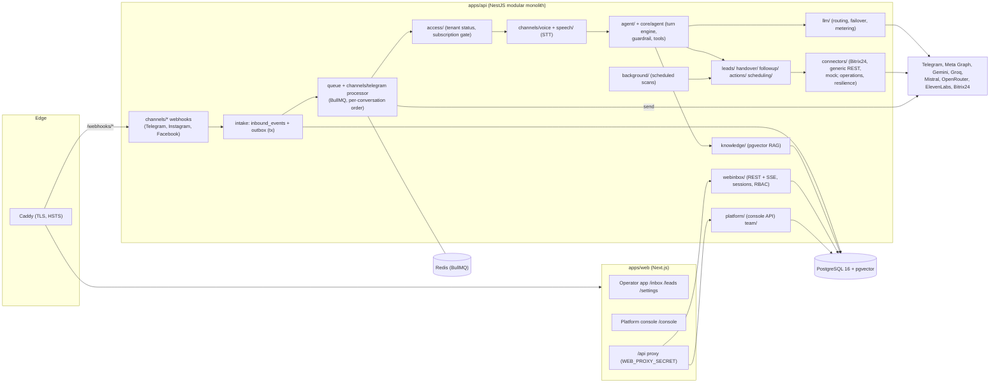
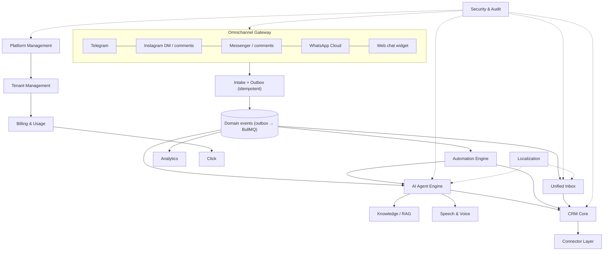

# AgentCore — architecture: current state and target (2026-11-10)

Tree: `origin/feat/production-pilot` @ `8dd5de0`. Principle kept: **Universal Core + Domain Pack + CRM Connector + Locale Pack + Tenant Configuration** (D8). Recommendation in one sentence: **evolve the existing modular monolith; do not split into microservices**. The seams that matter (queue workers, connectors, provider ports) already exist and can be scaled as separate processes of the same codebase.

## 1. Current architecture

**Modules (non-test files):** `agent` (20), `channels` (42: telegram, instagram, facebook, meta, voice), `connectors` (36), `core` (33: vertical-agnostic agent, actions, handover, knowledge, leads, llm, locales, scheduling, speech ports), `voice` (19, calls, parked), `webinbox` (27), `platform` (14), `handover` (16), `llm` (12), `leads` (8), `scheduling` (7), `access`, `team`, `speech`, `knowledge`, `followup`, `observability`, `secrets`, `ops`, `packs`, `locales`, `persistence`, `queue`, `background`, `health`, `http`. A CI architecture test (`core/architecture.spec.ts`) and `pnpm check:onboarding` keep vertical/CRM words out of `core/**` (rule 1).

**Request paths.** Browser → Caddy → Next.js; the web server proxies `/api/*` to the API with a shared secret, so the API is same-origin for the browser (no CORS needed). Only `/webhooks/*` reach the API directly; `/health` is not exposed.

**Message path.** Webhook (signature checked on raw bytes) → transaction: `inbound_events` (dedupe by provider id), contact, conversation, message, `outbox_events` → BullMQ job keyed per conversation → access gate (tenant status, subscription) → voice transcription when needed → agent turn (tier-0 gates, extraction FAST tier, code-driven catalog search, response STRONG tier with read-only tools, guardrail) → reply stored with a send idempotency key → channel sender → delivery state. Handover, leads, CRM sync and follow-ups hang off the same outbox.

**Auth.** Two principal types: tenant operators (`operator_sessions`, cookie `ac_session`, roles OWNER/ADMIN/OPERATOR/VIEWER) and platform admins (`platform_sessions`, cookie `ac_platform`, PLATFORM_OWNER/PLATFORM_SUPPORT). CSRF double-submit bound to the session, Origin check, scrypt, login limiter and lockout.

**Infrastructure.** One AWS EC2 instance (eu-central-1, ADR 035 pilot) running Docker Compose: Caddy, web, api, Postgres 16 + pgvector, Redis 7; images from ghcr.io; deploy from GitHub Actions by OIDC role + SSM; daily on-host `pg_dump`.

## 2. Coupling, duplication and scaling concerns (evidence-based)

| Concern | Evidence | Recommendation |
|---|---|---|
| The inbound processor for every channel lives in `channels/telegram/telegram-processor.ts` | Instagram and Messenger call into the Telegram processor | Rename/extract a channel-neutral `InboundProcessor` before WhatsApp and web chat are added (no behaviour change). |
| Contact identity is per channel account | `Contact @@unique([tenantId, channelAccountId, providerUserId])` | Introduce a person-level contact with channel identities (data model review §3.1). |
| Realtime is a polling bus over `inbox_events` | `webinbox/inbox-event-bus.ts` `setInterval` | Fine for one API instance; switch the bus to Redis pub/sub before running two API replicas. |
| Workers run inside the API process | queue runtimes started by the API | Allow the same image to start in "worker" mode (env flag) so webhooks/UI and agent turns scale separately. |
| Scheduled scans also run in the API process | `background/background.module.ts` | Single leader (Redis lock) before horizontal scaling; otherwise scans run twice. |
| Tenant isolation is a convention | every query passes `tenantId`; no RLS | Add Postgres RLS on the highest-risk tables as defence in depth (security review). |
| Platform code queries across tenants | `apps/api/src/platform/**` by design; import-boundary test | Keep the boundary test; never import platform code from tenant modules. |

## 3. Target architecture

| Module | Responsibility | Owns data | API boundary | Emits | Depends on | Tenant isolation | Scaling |
|---|---|---|---|---|---|---|---|
| 1 Platform Management | platform admins, tenant provisioning, invites, support access | `platform_*` | `/api/v1/platform/**` (own session) | `tenant.created`, `tenant.status_changed` | Tenant, Billing | cross-tenant **only here**, import boundary | low volume |
| 2 Tenant Management | tenant config, packs, locales, team, roles | `tenants`, `operators`, `operator_*`, teams | `/api/v1/team`, `/settings/*` | `operator.invited/changed` | Security | every row `tenant_id` | low |
| 3 Omnichannel Gateway | webhooks, normalisation, signatures, senders, windows, rate limits | `channel_accounts`, `channel_secrets`, `inbound_events` | `/webhooks/*`, `ChannelSender` port | `message.received`, `message.delivered` | Security | account → tenant resolved once | stateless; scale API replicas |
| 4 Unified Inbox | conversations, ownership, assignment, presence, read state, notes, canned replies, SLA | `conversations`, `internal_notes`, assignments, read markers, canned responses | `/api/v1/inbox`, `/handovers`, SSE | `conversation.assigned`, `handover.*` | CRM Core, Gateway | per tenant; SSE scoped by session tenant | Redis pub/sub for SSE fan-out |
| 5 CRM Core | person, identities, companies, opportunities (leads), pipelines, tasks, tags, fields, timeline | contacts, identities, companies, leads, pipelines, tasks, tags, activities | `/api/v1/contacts`, `/leads`, `/tasks` | `contact.merged`, `lead.stage_changed`, `task.due` | Connector Layer | tenant FK + composite uniques | Postgres; read models for boards |
| 6 AI Agent Engine | turn orchestration, tools, guardrail, handover triggers, playbooks | `agent_turns`, `conversation_slots`, `action_proposals` | internal (queue) | `turn.committed`, `handover.requested` | LLM, Knowledge, Speech, CRM | tools receive tenant from the turn, never from text | worker processes; per-conversation ordering |
| 7 Knowledge / RAG | ingestion, chunks, embeddings, regulated validity | `knowledge_*` | `/api/v1/knowledge/*` | `knowledge.ingested` | embeddings provider | tenant filter in every vector query | pgvector; later HNSW per tenant size |
| 8 Speech & Voice | STT for notes, (later) calls/TTS | none persistent (audio not stored) | `SpeechToText` port | `voice.transcribed/failed` | providers | per-tenant metering | stateless |
| 9 Automation Engine | trigger → condition → action/delay flows, versions, runs | `automation_flows`, `flow_versions`, `flow_runs`, `flow_step_runs` | `/api/v1/automations` | `flow.run.*` | Bus, CRM, Agent, Gateway | flows and runs carry tenant; actions reuse tenant-scoped services | BullMQ delayed jobs |
| 10 Connector Layer | CRM/catalog/calendar adapters, sync, idempotent writes | `tenant_connectors`, `connector_secrets`, `connector_operations`, `catalog_*` | `Connector` contracts | `sync.*` | external CRMs | secrets encrypted per tenant | leased operations |
| 11 Analytics | metrics, funnels, cost, SLA | read models / views | `/api/v1/analytics` | — | all events | tenant filter; platform rollups only in Platform | materialised daily aggregates |
| 12 Billing & Usage | plans, subscriptions, payments, Click, usage limits | `subscription_*`, usage counters | console + `/api/v1/subscription`, Click callbacks | `subscription.*`, `payment.*` | Platform, Gateway (limits) | tenant on every payment; Click signature verified | low |
| 13 Security & Audit | sessions, MFA, RBAC, audit, retention, secrets | sessions, `audit_events`, `platform_audit_events` | guards | `audit.*` | — | RLS defence in depth | — |
| 14 Localization | locale packs, script handling, UI i18n | locale packs (code) | — | — | — | — | — |

## 4. Integration strategy
- **Channels:** one adapter per channel behind the existing normaliser/sender pattern; WhatsApp Cloud API next (templates for the 24 h rule), then a first-party web chat widget (public, rate-limited session, same intake path).
- **CRMs:** keep AgentCore as the system of record for conversations and qualification; sync leads/contacts/deals out (Bitrix24 first, Kommo second) through `connector_operations`; two-way stage sync per ADR 034 (proposed).
- **AI providers:** keep the `LlmProvider` port and routing policy; measure before changing models (latency audit 2026-11-10).
- **Automation:** build internally on the outbox + BullMQ. Comparison:

| Option | Fit | Tenant isolation | Ops cost | Verdict |
|---|---|---|---|---|
| Internal declarative engine (JSON flow, versioned, executed by BullMQ jobs) | reuses guardrails, actions, connectors, budgets | native (same DB, same tenant checks) | low | **Recommended for v1** |
| Temporal | excellent durability and versioning | needs namespace/queue per tenant design | new cluster to run | revisit only if flows become long-running and complex |
| n8n / Node-RED embedded | fast visual builder | weak (shared credentials model, code nodes) | separate service, licence terms | not recommended for a multi-tenant SaaS core |

- **Billing:** Click Shop API (Prepare/Complete) for subscriptions first; customer payments only after an owner decision on D16.
